<div align="center">

# Dossier

Render AI-written work reports from one JSON file

[![Live][badge-site]][url-site]
[![HTML5][badge-html]][url-html]
[![CSS3][badge-css]][url-css]
[![JavaScript][badge-js]][url-js]
[![Claude Code][badge-claude]][url-claude]
[![License][badge-license]](LICENSE)

[badge-site]:    https://img.shields.io/badge/live_site-0063e5?style=for-the-badge&logo=googlechrome&logoColor=white
[badge-html]:    https://img.shields.io/badge/HTML5-E34F26?style=for-the-badge&logo=html5&logoColor=white
[badge-css]:     https://img.shields.io/badge/CSS3-1572B6?style=for-the-badge&logo=css3&logoColor=white
[badge-js]:      https://img.shields.io/badge/JavaScript-F7DF1E?style=for-the-badge&logo=javascript&logoColor=black
[badge-claude]:  https://img.shields.io/badge/Claude_Code-CC785C?style=for-the-badge&logo=anthropic&logoColor=white
[badge-license]: https://img.shields.io/badge/license-MIT-404040?style=for-the-badge

[url-site]:   https://dossier.neorgon.com/
[url-html]:   #
[url-css]:    #
[url-js]:     #
[url-claude]: https://claude.ai/code

</div>

---

## Overview

An agent finishes a piece of work and writes a report about it. Dossier takes
that report as a small typed JSON document and renders it: metric tiles with
derived deltas, charts, before-and-after comparisons, diffs, test runs and
findings. The agent states what it measured and the site does the arithmetic,
because a wrong number in a report about correctness is the worst defect this
kind of tool can ship.

Everything happens in your browser. There is no account, no server and no
session. A report you share travels inside its own link, and the one-file
export opens with no account, no install and no network.

**Live:** dossier.neorgon.com

---

## Features

- **Compare two responses** -- paste A and B with an optional shared prompt;
  switch between side-by-side and single-response views, or highlight changes
- **A report first** -- light and dark document surfaces, text controls, and an editor
  that opens when needed. The first visit shows a clearly labeled example
- **Compare runs and impact** -- paired bars use a shared scale, trends include
  legends and data tables, and templates connect results to next steps
- **One typed document** -- 27 block types described in a registry the
  validator, the renderer, the form, the schema and `llms.txt` all read, so
  they cannot disagree about the format
- **The renderer does the math** -- deltas, percentages, totals, diff line
  counts and axis ceilings are derived, never asked for
- **Evidence on any claim** -- every block takes sources, each marked with who
  established it: a machine check, a person, or the model itself
- **Before and after** -- side by side, a wipe between two images, an overlay
  or a toggle, with changed lines marked
- **Reads other formats** -- a git diff, JUnit XML, SARIF, CTRF, a Lighthouse
  report, a Conventional Commits log, Markdown, or plain HTML
- **HTML artifacts**: open a file, paste HTML, or drop it onto the workspace.
  The complete document retains styles, SVGs and inline controls. External
  assets must be embedded in the file; the preview has no network access.
- **Appearance**: the logo and Dark mode control stay visible in both workspace
  modes. The initial theme follows the system; your choice stays in this browser.
- **A form, not HTML** -- the block catalog previews each type with the real
  renderer, and the editing form is generated from the same registry
- **Share by link** -- the report is deflated into the URL fragment, with a
  live reading of whether it will survive a chat client
- **One file to keep** -- a self-contained HTML export with the stylesheets
  inlined and the design tokens resolved to literals
- **Findings panel** -- the linter coaches rather than rejects, and names the
  fix every time
- **Hidden chrome** -- `H` for the header, `R` for the editor, and a report
  arriving in a link opens with both already out of the way

---

## Block types

Grouped as the catalog shows them. The full field list is in `llms.txt`, and
`schema.json` is the machine-readable contract.

| Group | Blocks |
|---|---|
| Narrative | `heading` `prose` `callout` `quote` `steps` `kv` `grid` |
| Measurement | `metrics` `chart` `gauge` `scorecard` `table` |
| Work | `files` `diff` `code` `log` `checklist` `timeline` `findings` `tests` |
| Comparison | `compare` |
| Judgment | `risks` `actions` `decision` |
| Attachment | `image` `embed` `evidence` |

---

## Keyboard shortcuts

Registered through the fleet NeoKeys kit, so every one of them can be turned
off or rebound from the `?` sheet.

| Key | Does |
|---|---|
| `?` | The shortcut sheet, with the disable switch and rebinding |
| `H` | Hide or show the header |
| `R` | Read or edit |
| `/` | Filter reports and pages |
| `S` | Copy a share link |
| `E` | Export |
| `[` `]` | Previous and next page |

---

## For an agent writing a report

```bash
# The contract, and a worked example that validates clean
curl https://dossier.neorgon.com/llms.txt
curl https://dossier.neorgon.com/schema.json

# Check a report before handing it over
node bin/validate.mjs report.json   # 0 clean, 1 findings, 2 could not run
```

`schema.json` is JSON Schema draft-07, self-contained and under 60 KB, which
is what the agent platforms that accept a caller-supplied schema will take.

---

## Running locally

ES modules require an HTTP server (not `file://`):

```bash
make serve      # http://localhost:8899
make check      # registry audit, every test, the fixtures, the byte scan
make receipt    # build the one-file export and check it in a browser
npm run test:browser  # exercise the workspace while make serve is running
make schema     # regenerate schema.json, llms.txt and SKILL.md
```

---

## Architecture



```
dossier-site/
├── index.html              # the shell: header kit, three regions, dialogs
├── schema.json             # generated from the registry, draft-07
├── llms.txt  SKILL.md      # generated: the contract, as instructions
├── js/
│   ├── registry/           # the format itself, as data. Everything reads it
│   │   ├── types.js        # the field language, the envelope, the meta fields
│   │   ├── narrative.js    # one file per block group
│   │   ├── measurement.js
│   │   ├── work.js  results.js  judgment.js
│   │   └── index.js        # assembles, and audits itself
│   ├── parse.js            # text to model. Never throws, never destructive
│   ├── derive.js           # the arithmetic the author is not asked for
│   ├── validate.js         # the same rules in the browser, the CLI and tests
│   ├── adapters/           # git, JUnit, SARIF, CTRF, Lighthouse, md, HTML
│   ├── render/
│   │   ├── index.js        # the one renderer. Exports derive from its output
│   │   ├── dispatch.js     # type to module, built from each module's claim
│   │   ├── compare.js      # the before-and-after primitive
│   │   ├── charts.js       # the bridge to the fleet Viz Kit
│   │   └── url.js          # scheme allowlist for every rendered link
│   ├── store.js            # IndexedDB: report bodies, many of them
│   ├── share.js            # #dz= and ?src=, the fleet transport contract
│   ├── export.js           # JSON, YAML, one HTML file, print, a Sage deck
│   ├── catalog.js  forms.js  editor.js  findings-panel.js
│   └── chrome.js           # read mode, and the NeoKeys registration
├── css/                    # shell, report, blocks, authoring (+ vendored kits)
├── fixtures/               # minimal, complete (every block type), messy
├── reports/                # eleven starter templates, all validating clean
├── bin/                    # validate, gen-schema, gen-llms
└── tests/                  # plain node --test, plus a browser flow check
```

---

<div align="center">
<sub>Part of <a href="https://neorgon.com/">Neorgon</a></sub>
</div>
